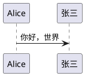

# Local PlantUML

在 Obsidian 里渲染 PlantUML 图，完全离线、无网络请求，支持中文与标准库（C4、ArchiMate、云厂商图标等）。



## 安装

### 社区插件目录

尚未提交/上架。上架后可在 `设置 → 第三方插件 → 浏览` 里搜索 **Local PlantUML**。

### BRAT

安装 [BRAT](https://github.com/TfTHacker/obsidian42-brat)，添加仓库：

```
DeeliN221/obsidian-local-plantuml
```

### 手动

从 [Releases](https://github.com/DeeliN221/obsidian-local-plantuml/releases) 下载 `main.js`、`manifest.json`、`styles.css`，放进：

```
<vault>/.obsidian/plugins/local-plantuml/
```

然后在 Obsidian 里启用 **Local PlantUML**。

> 官方 PlantUML 插件与它注册同一个 `plantuml` 代码块，二者只能启用一个。

## 用法

用带 `plantuml` 或 `puml` 标记的代码块写图。省略 `@startuml` / `@enduml` 也可以：

````markdown
```puml
Alice -> Bob : hello
```
````

标准库引用不需要联网：


## 说明

- 引擎、布局器和标准库都打包在 `main.js` 里，安装时只依赖 release 的三个文件。
- 中文依赖系统 CJK 字体：macOS/Windows 开箱可用，Linux 需先安装 CJK 字体。
- 暗色/亮色在渲染时读取，切换主题后重新打开笔记即可。
- 插件不发送任何网络请求。

## 构建

```sh
npm install
npm run build
```

产物在 `dist/local-plantuml/`。`npm run dev` 会在修改时重新构建。

## 许可

MIT，见 [LICENSE](LICENSE)。引擎与标准库的第三方许可见 [THIRD-PARTY-NOTICES.md](THIRD-PARTY-NOTICES.md)。
